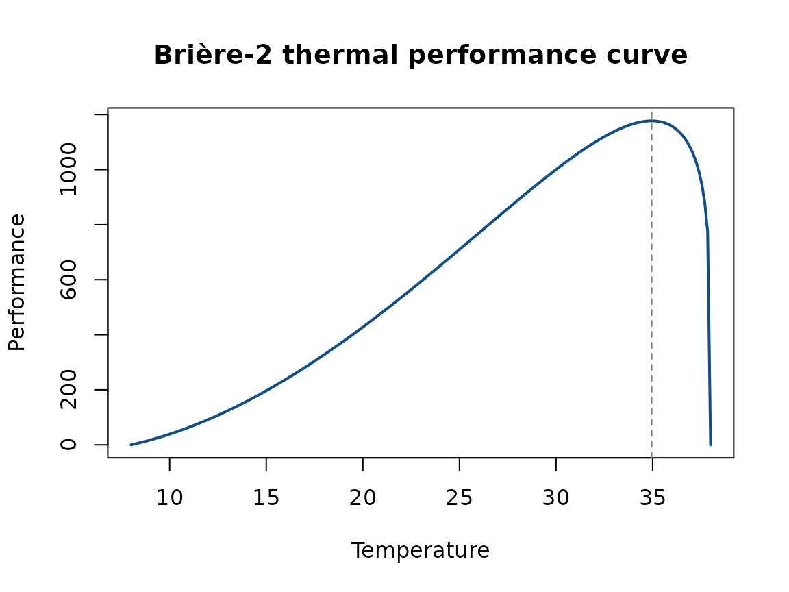
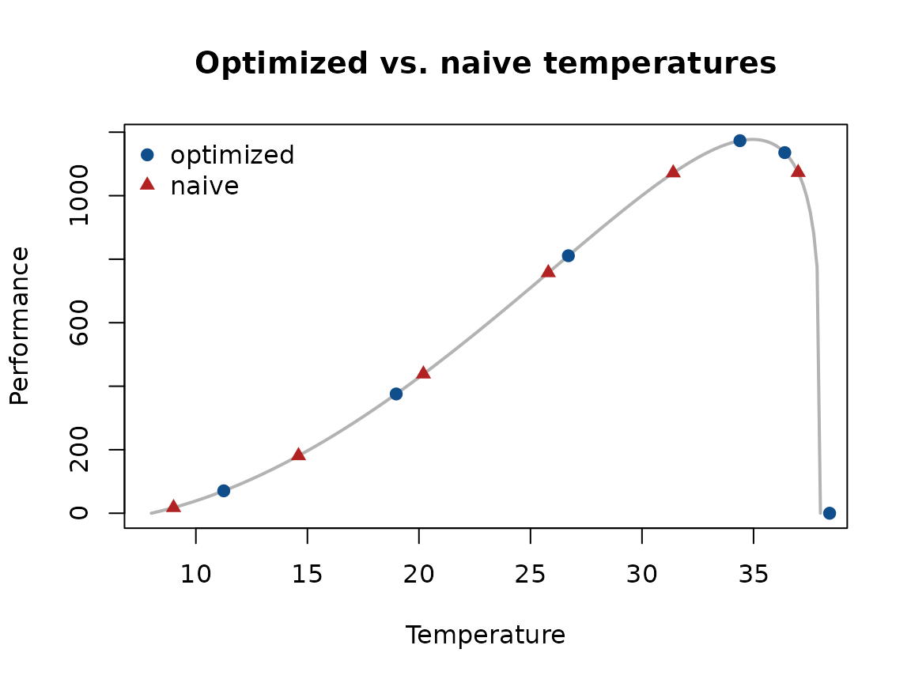

# Designing Informative Thermal Performance Experiments

## Motivation

Thermal performance curves (TPCs) describe how some measure of
performance (growth, fecundity, survival, etc.) changes with
temperature. Fitting a TPC requires choosing which temperatures to
measure performance at, and that choice matters: temperatures clustered
in an uninformative part of the curve (e.g., only near the thermal
optimum) can leave the edges of the curve – the critical thermal minimum
and maximum – poorly estimated, even with a large sample size.

TPCdesign helps you choose experimental temperatures that are maximally
informative for fitting a Brière-2 TPC, given a rough prior guess at
that curve’s shape. This vignette walks through the full workflow:

1.  Define a Brière-2 TPC using rough prior guesses at its parameters.
2.  Use
    [`design_temps()`](https://lucasnell.github.io/TPCdesign/reference/design_temps.md)
    to choose informative temperatures for that curve.
3.  Simulate data from the true curve at those temperatures with
    [`sim_gamma_data()`](https://lucasnell.github.io/TPCdesign/reference/sim_gamma_data.md).
4.  Fit the simulated data and check how well the true parameters are
    recovered, compared to a naive, equally-spaced set of temperatures.

``` r

library(TPCdesign)
```

## The Brière-2 TPC

The Brière-2 curve is parameterized by a lower thermal limit (`ctmin`),
an upper thermal limit (`ctmax`), and shape parameters `a` and `b`.
[`briere2_tpc()`](https://lucasnell.github.io/TPCdesign/reference/briere2_tpc.md)
evaluates the curve, and
[`briere2_tpc_Topt()`](https://lucasnell.github.io/TPCdesign/reference/briere2_tpc_Topt.md)
returns its thermal optimum:

``` r

true_ctmin <- 8
true_ctmax <- 38
true_a <- 1
true_b <- 0.2

temp_grid <- seq(true_ctmin, true_ctmax, length.out = 200)
perf <- briere2_tpc(temp_grid, true_ctmin, true_ctmax, true_a, true_b)
topt <- briere2_tpc_Topt(true_ctmin, true_ctmax, true_b)

plot(temp_grid, perf, type = "l", lwd = 2, col = "dodgerblue4",
    xlab = "Temperature", ylab = "Performance",
    main = "Brière-2 thermal performance curve")
abline(v = topt, lty = 2, col = "grey50")
```



In practice, you never know these parameters exactly ahead of time – you
only have rough guesses, which is exactly what
[`design_temps()`](https://lucasnell.github.io/TPCdesign/reference/design_temps.md)
is built to work with.

## Choosing informative temperatures

[`design_temps()`](https://lucasnell.github.io/TPCdesign/reference/design_temps.md)
takes your best guess at `ctmin`, `ctmax`, `a`, and `b`, along with how
uncertain you are about each of `ctmin`, `ctmax`, and `b` (`ctmin_err`,
`ctmax_err`, and `logb_err`, respectively), and searches for the set of
temperatures that is expected to be most informative across that range
of plausible curves. Here we ask for 6 temperatures, treating our
guesses above as uncertain by a few degrees:

``` r

set.seed(1)

opt_temps <- design_temps(
    n_temps = 6,
    ctmin = true_ctmin, ctmax = true_ctmax, a = true_a, b = true_b,
    ctmin_err = 2, ctmax_err = 1.5, logb_err = 0.26,
    n_draws = 100L, n_starts = 3L, n_filler = 1L
)
opt_temps
#> [1] 11.25 18.98 26.70 34.39 36.40 38.41
```

For comparison, a naive design might just space temperatures evenly
across the same range:

``` r

naive_temps <- round(seq(true_ctmin + 1, true_ctmax - 1, length.out = 6), 2)
naive_temps
#> [1]  9.0 14.6 20.2 25.8 31.4 37.0
```



Note how the optimized design concentrates more temperatures near
`ctmax`, where the curve is changing quickly and is therefore more
informative about where the curve actually crosses zero, while the naive
design spreads temperatures out with no regard for the curve’s shape.

## Simulating data

Once you have a set of temperatures,
[`sim_gamma_data()`](https://lucasnell.github.io/TPCdesign/reference/sim_gamma_data.md)
simulates performance measurements at them, with observation error drawn
from a gamma distribution. Temperatures at or outside `ctmin` and
`ctmax` have an expected performance of zero, so their simulated values
are 0:

``` r

dat_opt <- sim_gamma_data(opt_temps, n_reps = 6L, obs_cv = 0.15,
                          ctmin = true_ctmin, ctmax = true_ctmax,
                          a = true_a, b = true_b)
head(dat_opt)
#>    temp        y
#> 1 11.25 69.87929
#> 2 11.25 70.63575
#> 3 11.25 73.04957
#> 4 11.25 70.57304
#> 5 11.25 99.42176
#> 6 11.25 58.83897
```

## Does the optimized design actually help?

To check whether the optimized temperatures are worth using, we can
simulate data from both designs and fit the Brière-2 curve back to each
dataset, then compare how precisely the true parameters are recovered.
This requires the `nls.multstart` package, so this section is skipped if
it isn’t installed:

``` r

dat_naive <- sim_gamma_data(naive_temps, n_reps = 6L, obs_cv = 0.15,
                            ctmin = true_ctmin, ctmax = true_ctmax,
                            a = true_a, b = true_b)

# Search bounds for starting values, matching how uncertain we said we
# were when calling design_temps() above. These must be given in the same
# order the parameters first appear in the model formula below
# (a, ctmin, ctmax, b).
b_bounds <- exp(log(true_b) + c(-1, 1) * 0.26)
start_lower <- c(a = 0.5, ctmin = true_ctmin - 2, ctmax = true_ctmax - 1.5,
                 b = b_bounds[1])
start_upper <- c(a = 1.5, ctmin = true_ctmin + 2, ctmax = true_ctmax + 1.5,
                 b = b_bounds[2])

fit_tpc <- function(dat) {
    nls.multstart::nls_multstart(
        y ~ a * temp * pmax(temp - ctmin, 0) * pmax(ctmax - temp, 0)^b,
        data = dat, iter = 100,
        start_lower = start_lower, start_upper = start_upper,
        supp_errors = "Y", convergence_count = 30
    )
}

fit_opt <- fit_tpc(dat_opt)
fit_naive <- fit_tpc(dat_naive)

comparison <- rbind(
    truth = c(a = true_a, ctmin = true_ctmin, ctmax = true_ctmax, b = true_b),
    `optimized estimate` = coef(fit_opt),
    `optimized SE` = summary(fit_opt)$coefficients[, "Std. Error"],
    `naive estimate` = coef(fit_naive),
    `naive SE` = summary(fit_naive)$coefficients[, "Std. Error"]
)
round(comparison, 3)
#>                        a ctmin  ctmax     b
#> truth              1.000 8.000 38.000 0.200
#> optimized estimate 1.173 5.992 36.467 0.079
#> optimized SE       0.100 2.918  0.174 0.054
#> naive estimate     0.479 9.643 42.317 0.482
#> naive SE           0.612 2.393  6.971 0.434
```

In this simulation, the estimates from the optimized design are closer
to the true parameter values, and their standard errors are noticeably
smaller – especially for `ctmax` and `b`, which the optimized design
samples much more densely near the curve’s upper edge. This is the
practical benefit of using
[`design_temps()`](https://lucasnell.github.io/TPCdesign/reference/design_temps.md):
for the same number of temperatures and replicates, the resulting fit is
more precise.

## Summary

- [`briere2_tpc()`](https://lucasnell.github.io/TPCdesign/reference/briere2_tpc.md)
  and
  [`briere2_tpc_Topt()`](https://lucasnell.github.io/TPCdesign/reference/briere2_tpc_Topt.md)
  let you explore a candidate TPC before designing an experiment around
  it.
- [`design_temps()`](https://lucasnell.github.io/TPCdesign/reference/design_temps.md)
  turns rough prior guesses (and how uncertain you are about them) into
  a set of temperatures expected to be informative for fitting that
  curve.
- [`sim_gamma_data()`](https://lucasnell.github.io/TPCdesign/reference/sim_gamma_data.md)
  lets you simulate data from a design before running the real
  experiment, so you can sanity-check it (as we did above) or perform a
  full power analysis.
